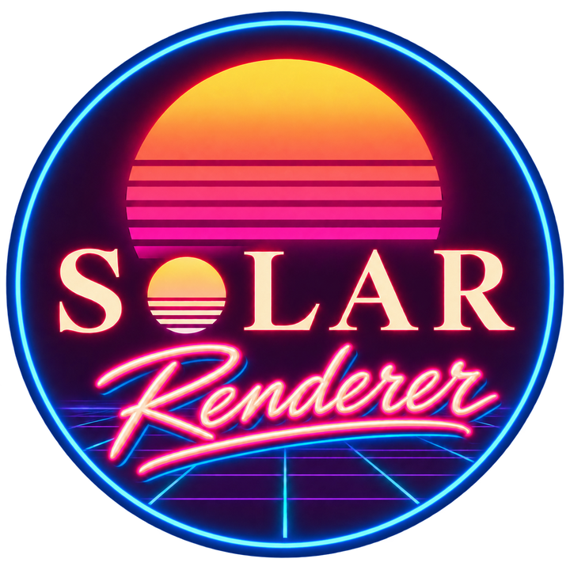

<p align="center">
  
</p>

<h1 align="center">SolarRenderer: Few-Step Generative Reference Rendering</h1>

<p align="center">
  🌐 <a href="https://enderfga.cn/SolarRenderer">Project Page</a> •
  🎮 <a href="https://huggingface.co/spaces/Enderfga/SolarRenderer">Online Demo</a> •
  🤗 <a href="https://huggingface.co/Enderfga/SolarRenderer">Weights</a> •
  🤗 <a href="https://huggingface.co/datasets/Enderfga/SolarRenderer-Data">Data</a>
</p>

Source of the SolarRenderer project page (`page` branch). Training and inference are on `main`, data processing on
`data`.

## Build

```bash
npm ci
npm run dev      # http://localhost:4321/SolarRenderer
npm run build    # static site in dist/
```

- Text and numbers: `src/data/` (`paper.json`, `results.json`, `gallery.json`, `compare.json`).
- Videos: loaded from `PUBLIC_MEDIA_BASE`, the `page/` folder of the dataset repository.
- Deploy: `.github/workflows/deploy.yml` builds and publishes with GitHub Pages on push to this branch.

## License

Code: Apache-2.0 (`LICENSE`). Fonts: SIL Open Font License. Weights: MiniMax H3 Community License, see the
[weights repository](https://huggingface.co/Enderfga/SolarRenderer). The layout started from the ORBIA project page.
