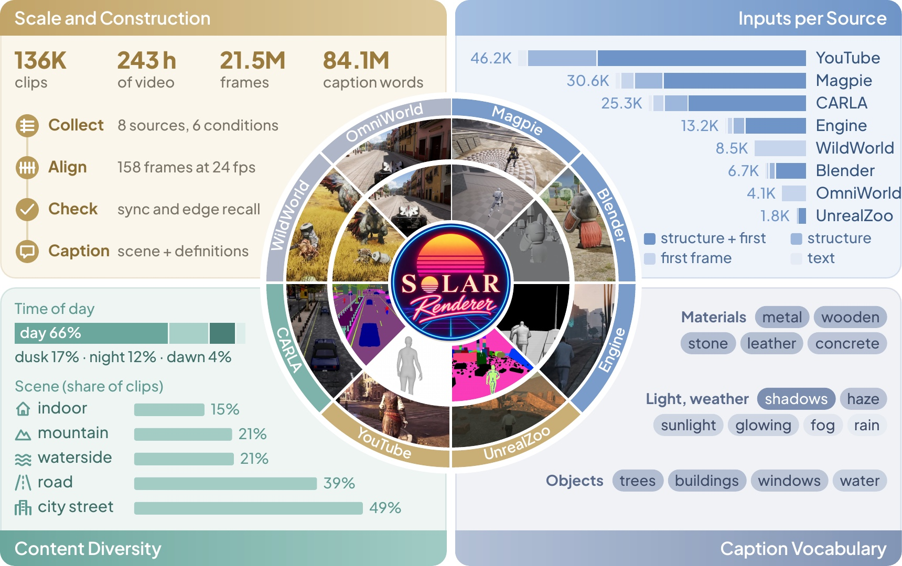

<p align="center">
  
</p>

<h1 align="center">SolarRenderer: Few-Step Generative Reference Rendering</h1>

<p align="center">
  🌐 <a href="https://enderfga.cn/SolarRenderer">Project Page</a> •
  🎮 <a href="https://huggingface.co/spaces/Enderfga/SolarRenderer">Online Demo</a> •
  📄 <a href="https://arxiv.org/abs/2610.28630">Paper</a> •
  🤗 <a href="https://huggingface.co/Enderfga/SolarRenderer">Weights</a> •
  🤗 <a href="https://huggingface.co/datasets/Enderfga/SolarRenderer-Data">Data</a>
</p>

This is the `data` branch of **SolarRenderer**: the code that made the
[released dataset](https://huggingface.co/datasets/Enderfga/SolarRenderer-Data).
Training and inference are on `main`, the project page on `page`.

<p align="center">
  
</p>

## Pipeline

| Step | Folder | What it does |
|---|---|---|
| 1 | [`sources/`](sources) | render or convert each source: Magpie, CARLA, UnrealZoo, Blender, WildWorld, OmniWorld |
| 2 | [`audit/`](audit) | check that structure and video line up; keep or drop each clip |
| 3 | [`clean/`](clean) | find black bars and overlays; crop or drop |
| 4 | [`caption/`](caption) | write the prompt of each clip with Kimi K2.6 |
| 5 | [`samples/`](samples) | first frames, one sample per clip, the training index |
| 6 | [`benchmark/`](benchmark) | the 208 hard cases and the 53 held-out clips |
| 7 | [`release/`](release) | pack the clips as trained on, shard, upload |

Each folder has its own README. Scripts read and write a storage location; locations come from arguments or
environment variables. Encoding into latents uses `tools/omni_preencode.py` on `main`.

📌 The training index has 136,289 rows from Magpie, CARLA, UnrealZoo, Blender, engine recordings with near-range depth,
YouTube, WildWorld and OmniWorld. Only the Magpie, CARLA and UnrealZoo clips are released; the engine-recording and
YouTube capture code is not here.

## Install

```bash
pip install -r requirements.txt    # plus ffmpeg and ffprobe on PATH
export PATH=$PWD/bin:$PATH
```

Scripts read and write storage through [`bin/solar-storage`](bin/solar-storage), a small `cp` / `ls` / `cat` / `run`
command built on fsspec: local paths work as they are, and `<scheme>://` URLs need the fsspec backend for that storage.
Set `STORAGE_CLI` to use another command with the same interface.

## License

Code: Apache-2.0 (`LICENSE`). Data: per source, see the
[dataset card](https://huggingface.co/datasets/Enderfga/SolarRenderer-Data). Weights: MiniMax H3 Community License,
see the [weights repository](https://huggingface.co/Enderfga/SolarRenderer).

## Citation

```bibtex
@misc{fang2026solarrenderer,
  title  = {SolarRenderer: Few-Step Generative Reference Rendering},
  author = {Fang, Guian and Qian, Shengju and Lu, Dongyue and
            Huang, Junchao and Jiang, Lutao and Wang, Xin and
            Song, Yiren and Jiang, Li and Shou, Mike Zheng},
  year   = {2026},
  eprint = {2610.28630},
  archivePrefix = {arXiv}
}
```
